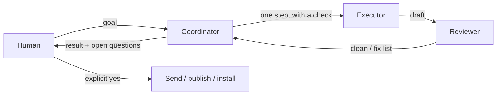

# human-in-the-loop-agent-team

A small, rule-first template for running a team of AI agents with a human in the loop: nothing is sent, published, or installed without your explicit yes. One **coordinator**, one **executor**, one **reviewer**, and a short shared rule set. It ships in two flavours, for **Claude Code** and for **Grok Bot**, with the same roles and the same rules.

This is a blueprint, not a framework. There is no runtime to install. It is a set of instruction files, skills, project templates, a fictional worked example, and a small check script.



## What's different

Large agent collections are great catalogs. This repo takes cues from them and deliberately does something narrower. These are the differences that are actually in the files:

1. **Three roles and a method, not a hundred agents.** Collections such as [affaan-m/ECC](https://github.com/affaan-m/ECC), [wshobson/agents](https://github.com/wshobson/agents) and [VoltAgent/awesome-claude-code-subagents](https://github.com/VoltAgent/awesome-claude-code-subagents) give you many specialists. Here you get one way of working that you can wrap around any specialist you already use.
2. **The coordinator never executes.** It plans, delegates one step at a time, and checks. Every piece of work happens in a separate executor session, so the coordinator keeps a clean view of the project.
3. **A human yes is a gate, not a habit.** Nothing is sent, published, installed, bought, or deleted without an explicit yes. Drafts are always allowed.
4. **Assumptions are declared.** Every result separates **Fact** (with a source), **Assumption**, and **Recommendation**. Missing data is written as `unknown`, never invented.
5. **Verify before delivery.** The reviewer checks the brief, the facts, the links, and runs a sensitive-data scan before anything reaches the human.
6. **Skills that learn.** Each role has a `lessons.md`: read before the work, updated after it, so the same mistake is not made twice.
7. **Two platforms, one design.** The same roles and rules work in Claude Code (files in the repo) and in Grok Bot (skills saved to a bot).

It is not a claim that this is "better" than those projects. It is a different trade-off: fewer moving parts, more control.

## The shared rules

The full text is in [RULES.md](RULES.md). In short:

| # | Rule |
|---|---|
| 1 | The coordinator never executes. It plans, delegates, and checks. |
| 2 | Nothing leaves without a human yes: no sending, publishing, installing, buying, or deleting. |
| 3 | Declare assumptions. Separate Fact, Assumption, and Recommendation. Unknown stays `unknown`. |
| 4 | Verify before delivery. The reviewer checks every result before the human sees it. |
| 5 | One project, one source of truth: `brief.md`, `status.md`, `decisions.md`, `log.md`. |
| 6 | Never delete silently. Old decisions move to a *History* section. |
| 7 | No personal data, client data, or credentials in project files. |

## Repository layout

```text
human-in-the-loop-agent-team/
  README.md
  RULES.md                    # the shared rules, for every role
  LICENSE                     # MIT
  CHANGELOG.md
  docs/
    architecture.md           # how the roles fit together, and why
    adapting.md               # how to add a specialist or change a rule
  templates/project/          # copy this for every new project
    brief.md  status.md  decisions.md  log.md
  claude-code/                # drop-in files for a Claude Code project
    CLAUDE.md
    .claude/settings.json     # asks before push, blocks reading secrets
    .claude/agents/           # executor and reviewer subagents
    .claude/skills/           # coordinator, executor, reviewer skills (+ lessons.md)
  grok-bot/                   # the same roles as Grok Bot skills
    README.md  bot-brief.md
    skills/team-coordinator/  skills/team-executor/  skills/team-reviewer/
  examples/example-bakery-newsletter/   # a full run on a fictional company
  scripts/check-sensitive.sh  # grep-based scan used by the reviewer
```

## Quick start

### Claude Code

1. Copy the contents of `claude-code/` into the root of your project (including the hidden `.claude/` folder), together with `RULES.md`, `templates/`, and `scripts/`.
2. Copy `templates/project/` to `projects/<your-project>/` and fill in `brief.md`.
3. Optional: list names that must never appear (people, clients, internal project names) in a local `.sensitive-terms` file. It is ignored by git.
4. Start Claude Code in the project and ask:

   > Use the coordinator skill. Open the project in `projects/<your-project>/` and propose the first three steps.

The main session plays the coordinator. It hands each step to the `executor` subagent and each result to the `reviewer` subagent, then reports back to you.

### Grok Bot

1. Create a bot (or pick an existing one) and paste [grok-bot/bot-brief.md](grok-bot/bot-brief.md) as its first message.
2. For each folder in `grok-bot/skills/`, ask the bot to save it as a skill, for example:

   > Save this as a skill called "team-coordinator". Keep the text as it is. *(paste the SKILL.md)*

3. Start a project:

   > Use team-coordinator. New project: *(one-line goal)*. Ask me only what is missing for the brief.

See [grok-bot/README.md](grok-bot/README.md) for details.

## Example

[examples/example-bakery-newsletter](examples/example-bakery-newsletter/) is a full run on a **fictional** company, *Example Bakery (fictional)*, a small neighbourhood bakery that wants a monthly email newsletter.

What you can see in it:

- the brief, the status, the decisions, and the log, as the coordinator keeps them;
- the executor's draft newsletter, with its assumptions declared;
- the reviewer's report, which caught an invented number and a missing consent check;
- the final status: **ready, waiting for a human yes**. Nothing is sent.

A typical coordinator report looks like this:

```text
Project: example-bakery-newsletter — step 2 of 3 done

Fact: draft newsletter ready (outputs/newsletter-draft-v2.md); reviewer result: clean.
Assumption: subscribers gave consent on the shop's sign-up form (not verified — owner to confirm).
Recommendation: send to a test list first.

Needs your yes: send the newsletter. Options: 1) Approve test send (recommended) 2) Edit 3) Stop
```

## What this is not

- Not a framework or a hosted service; nothing runs by itself.
- Not a security boundary. Rules written in prompts guide an agent; they do not enforce. Use your platform's permission settings as well (see `claude-code/.claude/settings.json`).
- Not a copy of any live system. Everything here was written from scratch, with fictional data.

## License

[MIT](LICENSE).
