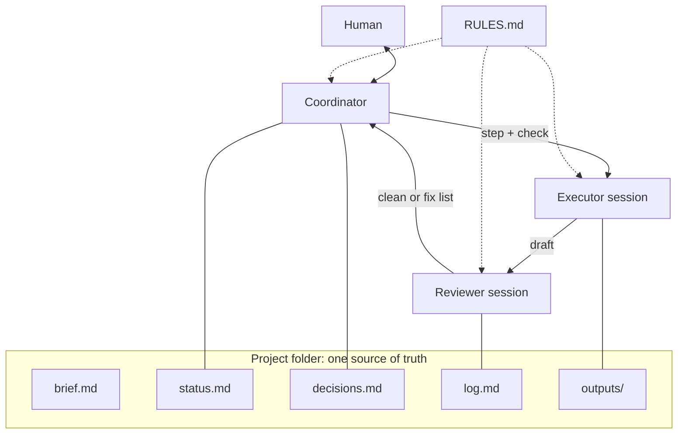

# Architecture

## The problem

A single general-purpose chat does not hold up when the work is mixed. Three things go wrong:

1. Rules live only in the conversation and get forgotten.
2. A long piece of work fills the context, and the overview is lost.
3. It becomes too easy to publish, install, or send something by mistake.

## The approach

Split the work into three roles with narrow jobs, and give them one short written rule set.

| Role | Does | Never does |
|---|---|---|
| Coordinator | Talks to the human, plans up to three steps, delegates, keeps the bookkeeping, reports | Writes the deliverable; sends or publishes |
| Executor | One step, one draft, assumptions declared | Sends, publishes, installs, buys, deletes |
| Reviewer | Checks brief, facts, links, sensitive data | Fixes the draft itself; approves an action |

## Why these choices

- **Written rules beat implied ones.** A policy that lives only in an earlier chat will be dropped. A short shared file is easier to follow and easier to correct.
- **Narrow roles make mistakes visible.** When an agent has one job, it is clear when it steps outside it.
- **The coordinator stays clean.** Because it never does the long work, its context holds the plan, the decisions, and the open questions, not hundreds of lines of draft.
- **Fact, assumption, and recommendation are a rule, not a style.** Mixing them is how invented numbers slip in.
- **Silence is a feature.** A check with nothing new to say should not send a message.
- **Skills should learn.** Each role keeps a `lessons.md`, read before and updated after each run.

## Platform notes

- **Claude Code.** The main session is the coordinator. Executor and reviewer are subagents in `.claude/agents/`, each with its own context and a restricted tool list. `settings.json` asks before `git push` and installs, and blocks reading secret files.
- **Grok Bot.** The coordinator is the bot you talk to. Executor and reviewer run as separate sessions or as separate bots holding the matching skill. Keep risky actions on *ask first* in the app's approval settings.

## Limits

- Prompts guide behaviour; they do not enforce it. Use the platform's permission settings too.
- Separate roles are not a security boundary when they share the same machine and accounts.
- More hand-offs cost more usage. Add a role only when the existing ones are overloaded.
